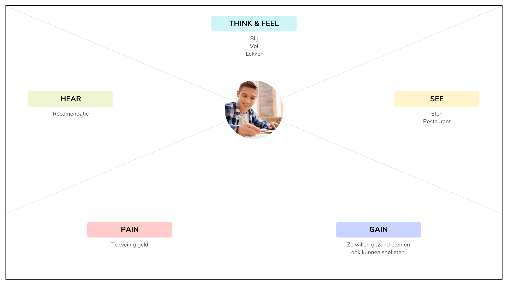

# Fase 1: Empathize (Begrijp de gebruiker)
## 1. Doelgroeponderzoek

* **Wie is onze gebruiker?**
Onze gebruiker is een jongere uit Generatie Z. 

Deze gebruiker heeft een drukke levensstijl, kiest snel voor digitaal gemak (zoals bezorg-apps/fastfood sites), heeft vaak een beperkt budget en weinig kookervaring. Tegelijkertijd is deze generatie zich volledig gewend aan snelle en visuele interfaces (zoals TikTok en Instagram) en altijd en overal online via hun smartphone. 

Op het platform wil deze gebruiker snel geïnspireerd worden, makkelijk recepten zoeken op ingrediënt of type gerecht en eigen recepten kunnen toevoegen, aanpassen of delen.

* **Pijnpunten (Pains):**
Jongeren koken steeds minder door tijdgebruik, gebrek aan kookvaardigheden en omdat het erg verleidelijk is om online te bestellen. Dit zorgt voor een ongezonder eetpatroon, hoge uitgaven met een niet zo'n hoge budget (onze gebruikers zijn meerendeels studenten), gezondheidrisico's en vaak eten mensen niet meer samen met elkaar.
  
* **Behoeftes (Gains):**
De gebruiker heeft behoefte aan snelle, visuele inspiratie en direct digitaal gemak. Omdat kookervaring vaak ontbreekt, zoekt deze doelgroep toegankelijke hulp, zoals eenvoudige recepten en (onder bepaalde voorwaarde) kooktips. Financieel gezien is er een sterke behoefte aan budgetvriendelijke maaltijden die goedkoper zijn dan online bestellen.
  
## 2. Empathy Map (Visueel)

  
## 3. Conclusie
*Wat is het belangrijkste inzicht dat we meenemen naar de Define fase?*
* Het belangrijkste inzicht dat we meenemen naar de Define-fase is een diepgaand begrip van de gebruiker, specifiek hun werkelijke behoeften, pijnpunten en onuitgesproken motivaties die zijn ontdekt tijdens de Empathize-fase
