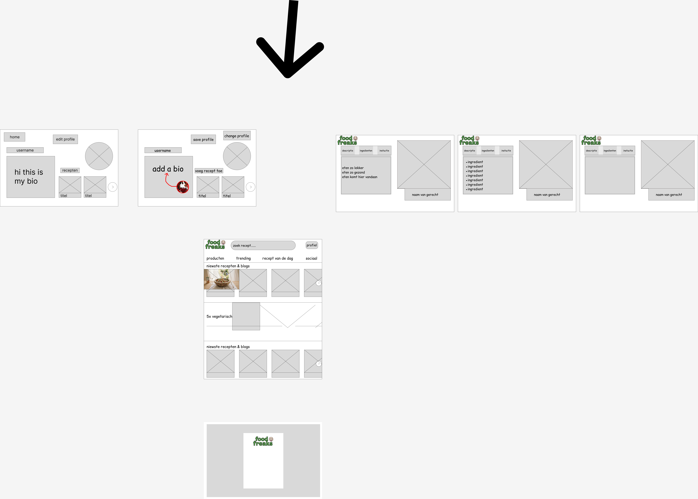

# Fase 4: Prototype (Ontwerp & Techniek)

## 1. Wireframes (Lo-Fi)

## 2. Visual Design (Hi-Fi)
[View Visual Design on Figma](https://www.figma.com/proto/BUL3VN7yrqEsX4ZLUHR8cl/Untitled?node-id=1-2)

## 3. Technische Architectuur
* **Frontend:** HTML, CSS en Vanilla JavaScript. HTML zorgt voor de structuur, CSS voor de vormgeving en JavaScript voor de interactieve onderdelen van de website.
* **Backend/Data:** PHP en een database. PHP verwerkt gegevens en zorgt voor de communicatie met de database, waarin recepten en gebruikersgegevens worden opgeslagen en opgehaald
